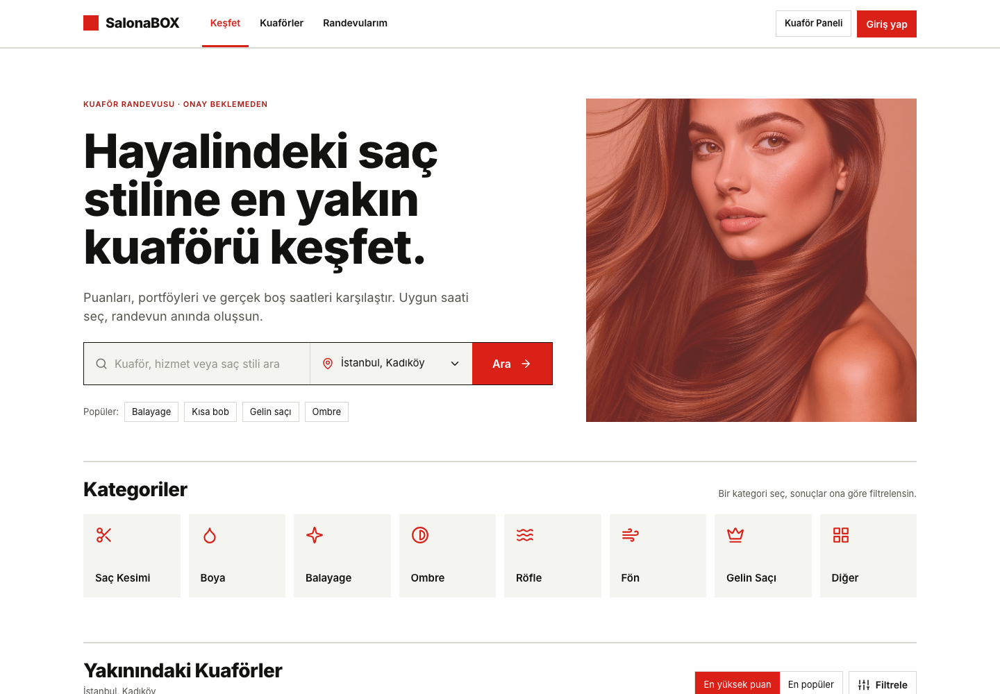
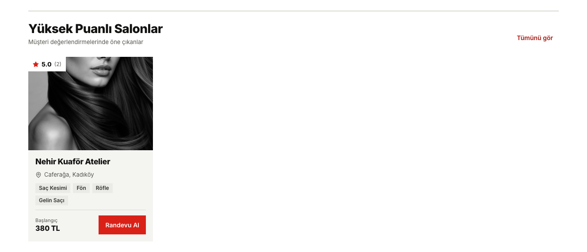
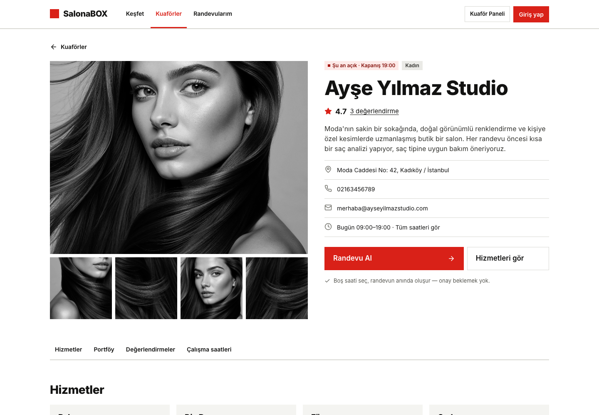
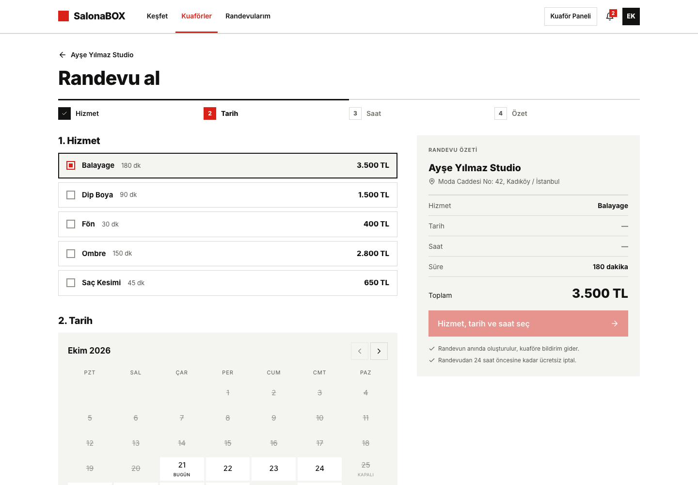
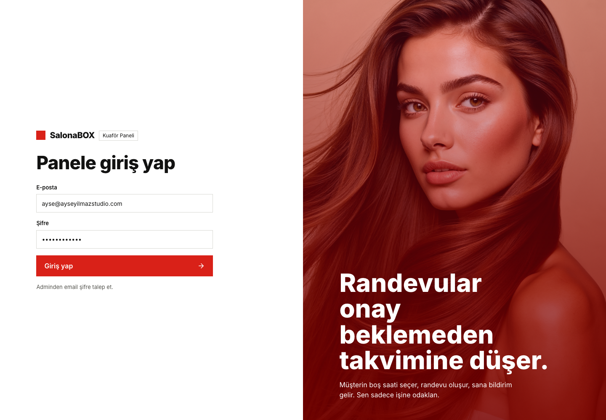
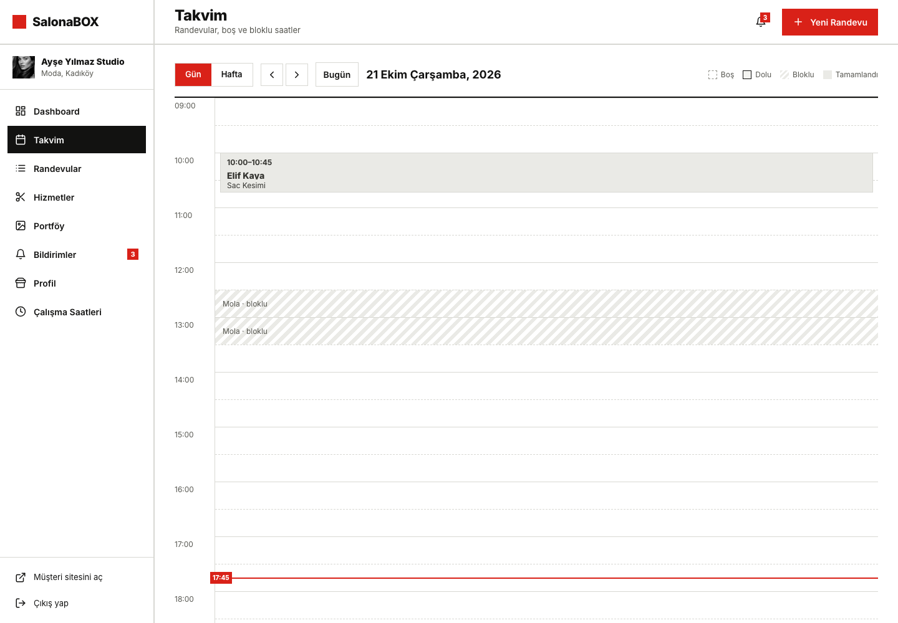
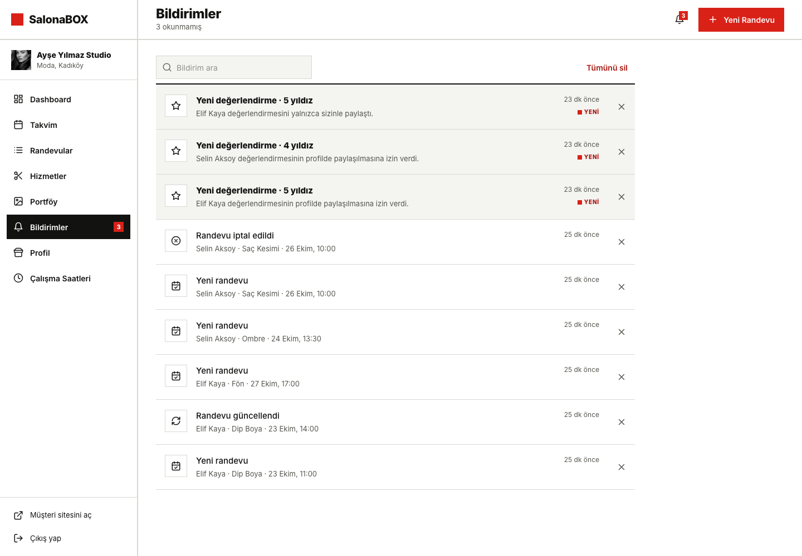
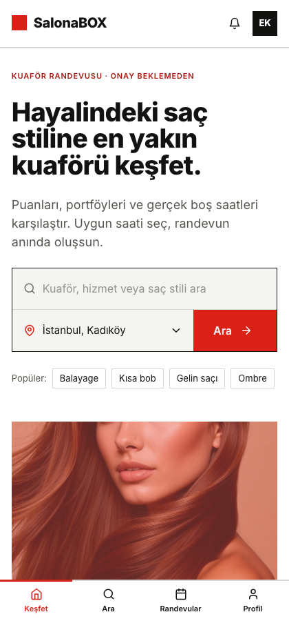

# SalonaBOX

Kuaför ve güzellik salonu randevu platformu. Müşteri salonları puan, portföy ve gerçek boş saatlere göre karşılaştırır, uygun saati seçer ve randevusu onay beklemeden oluşur. Salon sahibi ise randevularını, takvimini, hizmetlerini ve portföyünü tek bir panelden yönetir.



## İçindekiler

- [Özellikler](#özellikler)
- [Ekran görüntüleri](#ekran-görüntüleri)
- [Kullanılan teknolojiler](#kullanılan-teknolojiler)
- [Mimari](#mimari)
- [Proje yapısı](#proje-yapısı)
- [Kurulum](#kurulum)
- [Testler](#testler)
- [Sayfalar](#sayfalar)
- [Sürümler](#sürümler)
- [API](#api)
- [Lisans](#lisans)

## Özellikler

### Müşteri

- Konuma göre yakındaki kuaförleri listeleme
- Hizmet, saç stili, puan ve mesafeye göre arama ve filtreleme
- Salon profili, portföy galerisi, değerlendirmeler ve çalışma saatleri
- Hizmet, tarih ve saat seçerek anında randevu alma
- Randevuları görüntüleme, iptal etme ve takvime (.ics) ekleme
- Tamamlanan randevuya fotoğraflı değerlendirme yazma
- Bildirimler ve profil ayarları

### Salon paneli

- Günün özeti, doluluk oranı ve yaklaşan randevular
- Günlük ve haftalık takvim görünümü
- Elle randevu girme, düzenleme, iptal etme; tamamlandı / gelmedi olarak işaretleme
- Müşteri, telefon, hizmet veya randevu numarasıyla Türkçe karakterlere duyarsız arama
- Hizmet ekleme, düzenleme, silme
- Çalışma saatleri (kaydetmeden önce doğrulanır) ve kapalı günler
- Portföy yönetimi, müşteri fotoğraflarını izinle yayınlama
- Salon profili, bildirimleri tek tek veya toptan silme

## Ekran görüntüleri

| Yüksek puanlı salonlar |
| --- |
|  |

| Kuaför arama | Salon detayı |
| --- | --- |
|  |  |

| Randevu alma | Randevularım |
| --- | --- |
|  |  |

| Panel girişi | Panel özeti |
| --- | --- |
|  |  |

| Panel takvimi | Panel bildirimleri |
| --- | --- |
|  |  |

| Mobil görünüm |
| --- |
|  |

## Kullanılan teknolojiler

Projede kullanılan bütün paketler açık kaynak ve ücretsizdir; ücretli bir servis veya API kullanılmaz.

| Katman | Teknoloji |
| --- | --- |
| Arayüz | Next.js 16 (App Router), React 19, Tailwind CSS 4, Axios, TanStack Query 5 |
| Sunucu | Node.js 20+, Express 5 |
| Veritabanı | MongoDB, Mongoose |
| Kimlik doğrulama | JWT (access + refresh token), bcrypt |
| Doğrulama | Zod |
| Görsel saklama | MongoDB GridFS |
| Güvenlik | Helmet, CORS, istek limiti |
| Test | Vitest (arayüz), Node test runner, Supertest, in-memory MongoDB (API) |

## Proje yapısı

```
salonify/
├── client/                 Next.js arayüzü
│   ├── src/
│   │   ├── app/            sayfalar (rotalar)
│   │   ├── components/     ortak bileşenler (atoms, molecules, organisms)
│   │   ├── features/
│   │   │   ├── customer/   müşteri modülleri, her modülün hooks/ klasörü
│   │   │   └── panel/      kuaför paneli ekranları ve hooks/ klasörü
│   │   ├── data/           sabit listeler (kategoriler, şehirler)
│   │   ├── lib/
│   │   │   ├── api/        ApiClient (singleton) ve hata dönüşümleri
│   │   │   ├── queryClient.js, queryKeys.js
│   │   │   └── search.js, hooks.js, tarih ve biçim yardımcıları
│   │   └── styles/         genel stiller ve renk paleti
│   └── tests/              Vitest uç durum testleri
├── server/                 Express API
│   ├── src/                routes, controllers, services, models, validators
│   ├── scripts/            örnek veri script'i
│   └── tests/              API testleri
└── docs/screenshots/ README görselleri
```

## Mimari

### Veri katmanı

- **`ApiClient` (singleton):** `lib/api/ApiClient.js` tek bir axios örneği tutar. `ApiClient.getInstance()` her yerde aynı nesneyi döner, ikinci bir `new ApiClient()` hata fırlatır. Erişim token'ı bu nesnede saklanır, 401 alan istek bir kez yenilenen token ile tekrar denenir, aynı anda gelen yenileme istekleri tek isteğe indirilir.
- **`QueryClient` (singleton):** `lib/queryClient.js` tarayıcıda tek bir TanStack Query istemcisi oluşturur. 4xx hatalarında tekrar denenmez.
- **Sorgu anahtarları:** Bütün anahtarlar `lib/queryKeys.js` içinde toplanır. Mutation'lar ilgili anahtarları geçersiz kılar ya da önbelleği doğrudan günceller.

### Hook'lar

Her sayfa verisini `useQuery` / `useMutation` hook'larından alır, sayfa bileşenlerinde `useEffect` ile veri çekilmez.

| Modül | Hook'lar |
| --- | --- |
| Oturum | `AuthProvider` (oturum `useQuery` ile geri yüklenir), `useLogin`, `useRegister`, `useLogout` |
| Ana sayfa / arama | `useNearbySalons`, `usePopularSalons`, `useTopRatedSalons`, `useSalons` |
| Salon | `useSalon`, `useSalonReviews` |
| Randevu alma | `useAvailability`, `useBookAppointment` |
| Randevularım | `useAppointments`, `useAppointment`, `useCancelAppointment`, `useCreateReview` |
| Profil | `useMyReviews`, `useUpdateProfile`, `useChangePassword`, `useDeleteAccount` |
| Bildirimler | `useNotificationList`, `useMarkNotificationRead`, `useMarkAllNotificationsRead`, `useDeleteNotification`, `useDeleteAllNotifications` (iyimser güncelleme, dakikada bir yenileme) |
| Panel | `useMySalon`, `useUpdateSalon`, `useUploadCover`, `useDashboard`, `usePanelAppointments`, `useSaveAppointment`, `useUpdateAppointmentStatus`, `useServices`, `useSaveService`, `useDeleteService`, `usePanelSchedule`, `useSaveWorkingHours`, `useAddBlockedDate`, `useRemoveBlockedDate`, `usePortfolio`, `useTogglePortfolioItem` |

`PanelProvider` yalnızca arayüz durumunu (açık randevu, form, onay penceresi) tutar; panel verisinin tamamı hook'lardan gelir.

### Arama

`useSearchFilter` (`lib/hooks.js`) listeyi `useMemo` ile filtreler, yazarken arayüzün takılmaması için `useDeferredValue` kullanır. `lib/search.js` metni Türkçe kurallarla küçültüp aksanlardan arındırır; "sac kesimi" yazınca "Saç Kesimi" bulunur, birden çok kelime farklı alanlarda aranabilir.

### API yanıtlarının gösterimi

- `QueryState` sorgunun yükleniyor, hata ve boş durumlarını tek yerde yönetir; hata durumunda sunucunun mesajını ve "Tekrar dene" butonunu gösterir.
- `ErrorNotice` form hatalarında sunucunun mesajını ve doğrulama hatalarını alan alan listeler.
- Silme gibi işlemlerde sunucunun döndürdüğü mesaj bildirim (toast) olarak gösterilir. Ağ hatası ve zaman aşımı için ayrı mesajlar vardır.

## Kurulum

Gereksinim: Node.js 20 veya üzeri, MongoDB (yerel kurulum veya MongoDB Atlas ücretsiz paket).

Arayüz ve API aynı ortam dosyasını kullanır. Proje kökündeki `.env.example` dosyası `.env` olarak kopyalanıp doldurulur:

```bash
cp .env.example .env
```

Değişkenlerin açıklaması: [server/README.md](server/README.md#kurulum)

### Arayüz

```bash
cd client
npm install
npm run dev        # http://localhost:3000
```

Üretim derlemesi:

```bash
npm run build
npm start
```

### Sürümler

| Sürüm | Değişiklikler |
| --- | --- |
| v1.2.0 | `useMemo` + `useDeferredValue` ile Türkçe duyarsız arama, Vitest uç durum testleri, çalışmayan özelliklerin kaldırılması, yeni tasarım (sıcak palet, yuvarlak köşeler, renkli görseller), site simgesi |
| v1.1.1 | Singleton `ApiClient` ve `QueryClient`, tüm sayfaların TanStack Query hook'larına bağlanması, API yanıtlarının ekranda gösterilmesi |

## API

```bash
cd server
npm install
npm run seed       # örnek veriyi yazar
npm run dev        # http://localhost:5000/api
```

Gerekli ortam değişkenleri ve bütün uçların açıklaması için: [server/README.md](server/README.md)

## Testler

```bash
cd client
npm test           # Vitest: arama, API istemcisi, hata dönüşümü, tarih, çalışma saatleri, URL filtreleri

cd server
npm test           # API uçları, örnek veri ve zaman yardımcıları (in-memory MongoDB)
```

Arayüz testleri uç durumlara odaklanır: boş/null alanlar, Türkçe büyük-küçük harf (İ, ı), bozuk URL parametreleri, ay/yıl geçişleri, ağ hatası ve HTML dönen hata yanıtları, yarım girilmiş mola saatleri, singleton'ın ikinci kez oluşturulamaması.

### Örnek hesaplar

Ekran görüntülerindeki veriler bu hesaplarla uygulama üzerinden oluşturuldu. Hepsinin şifresi `Salonabox123`.

| Hesap | E-posta | Giriş |
| --- | --- | --- |
| Kuaför: Ayşe Yılmaz Studio | `ayse@ayseyilmazstudio.com` | `/panel/giris` |
| Kuaför: Nehir Kuaför Atelier | `deniz@nehirkuafor.com` | `/panel/giris` |
| Müşteri: Elif Kaya | `elif.kaya@posta.com` | `/giris` |
| Müşteri: Selin Aksoy | `selin.aksoy@posta.com` | `/giris` |

## Sayfalar

### Müşteri

| Rota | Sayfa |
| --- | --- |
| `/` | Ana sayfa, kategoriler ve yakındaki kuaförler |
| `/kuaforler` | Kuaför arama ve filtreleme |
| `/kuaforler/[salonId]` | Salon detayı |
| `/kuaforler/[salonId]/randevu` | Randevu alma |
| `/randevularim` | Yaklaşan ve geçmiş randevular |
| `/randevularim/[id]` | Randevu detayı |
| `/randevularim/[id]/basarili` | Randevu oluşturuldu ekranı |
| `/randevularim/[id]/degerlendir` | Değerlendirme yazma |
| `/bildirimler` | Bildirimler |
| `/profil` | Profil ve ayarlar |

### Salon paneli

| Rota | Sayfa |
| --- | --- |
| `/panel/giris` | Panel girişi |
| `/panel` | Özet |
| `/panel/takvim` | Takvim |
| `/panel/randevular` | Randevu listesi |
| `/panel/hizmetler` | Hizmetler |
| `/panel/calisma-saatleri` | Çalışma saatleri ve kapalı günler |
| `/panel/portfoy` | Portföy |
| `/panel/bildirimler` | Bildirimler |
| `/panel/profil` | Salon profili |

## API

Hangi ucun hangi sayfada ne işe yaradığı [server/README.md](server/README.md) dosyasında anlatılıyor.

## Lisans

Tescilli yazılım, tüm hakları saklıdır. Ayrıntılar için [LICENSE](LICENSE).
