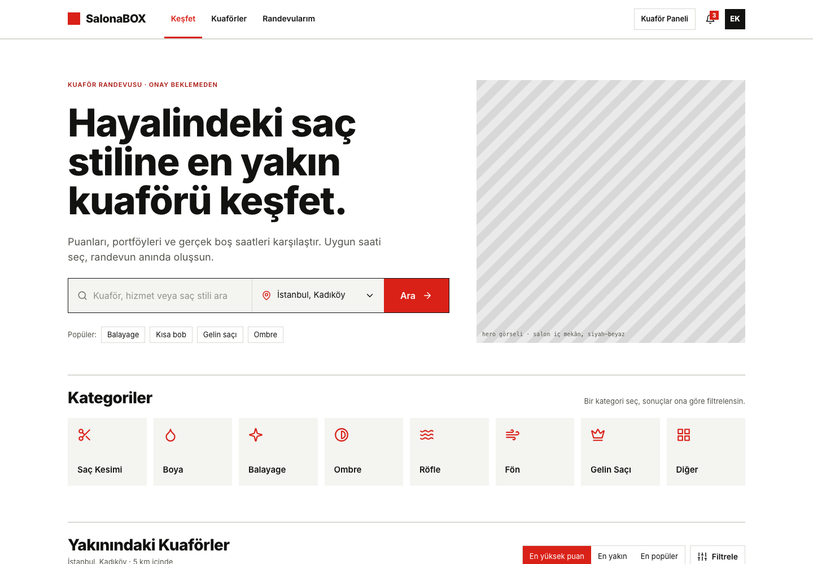
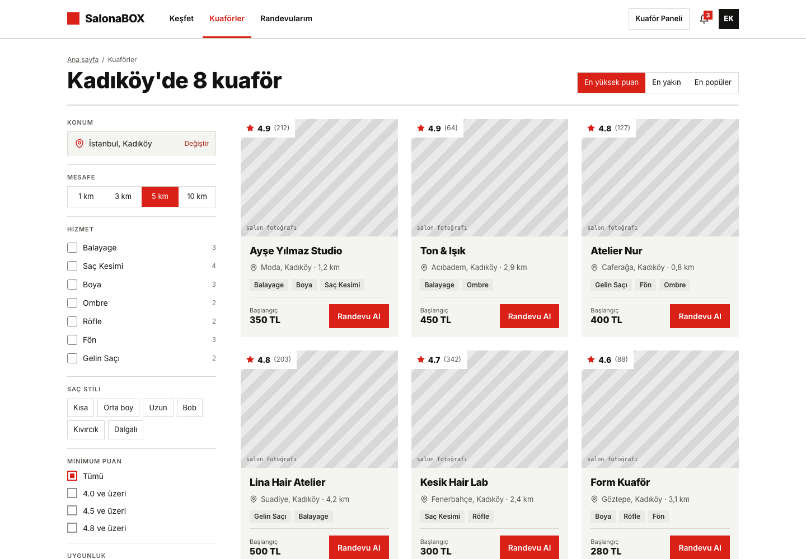
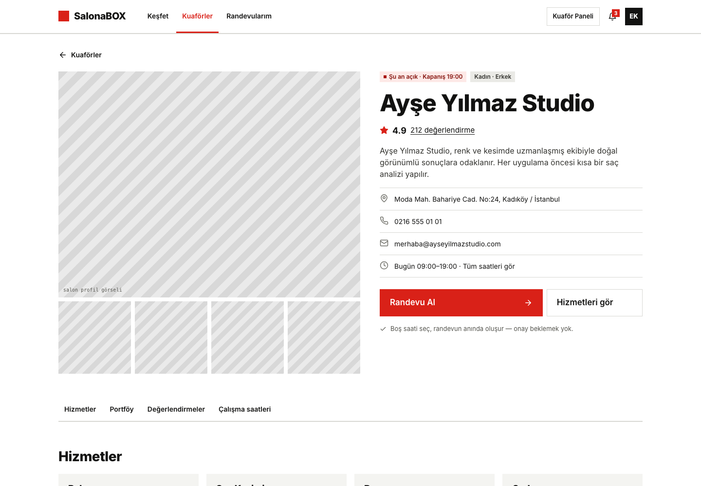
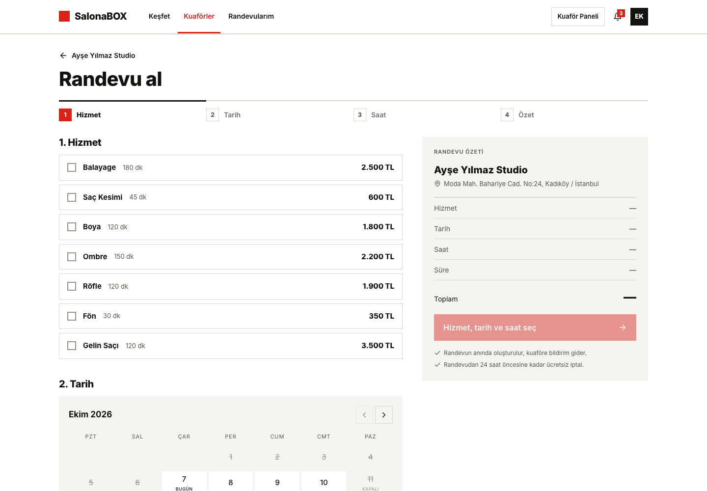
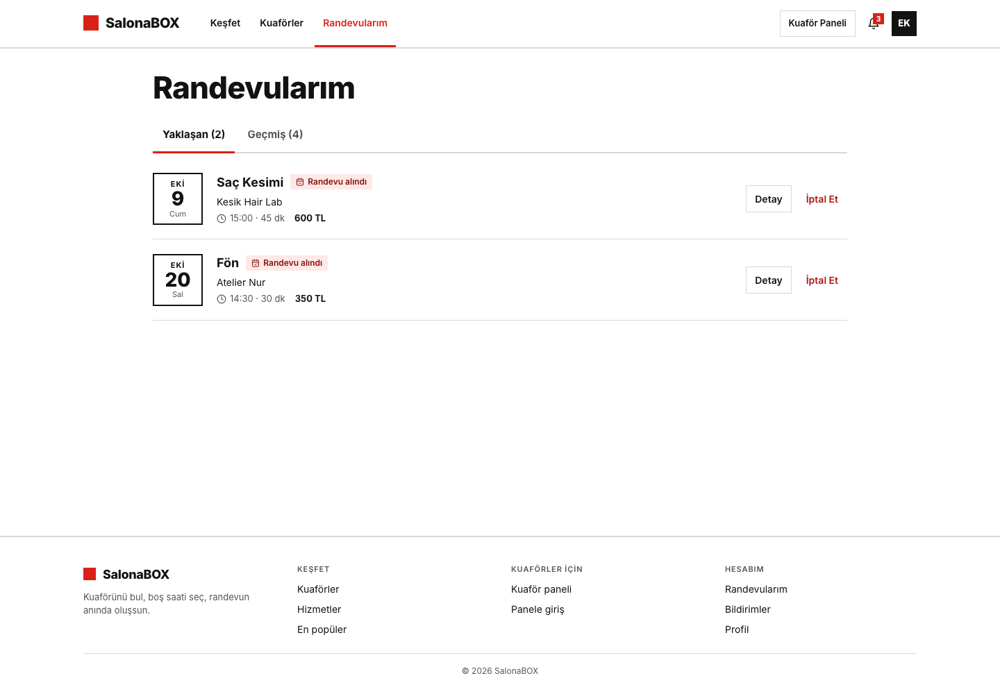
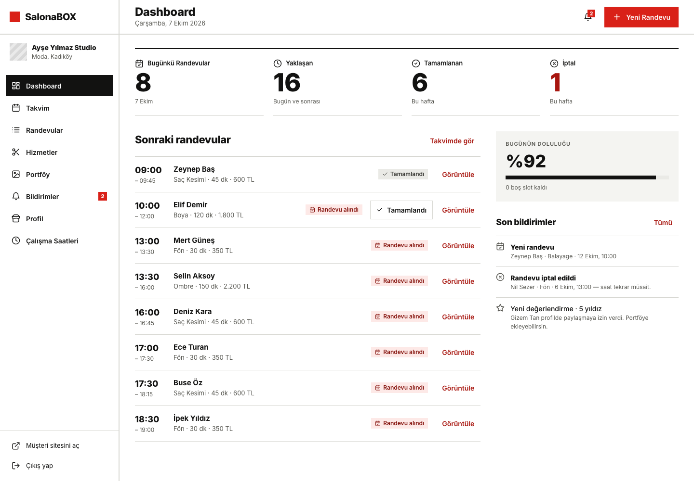
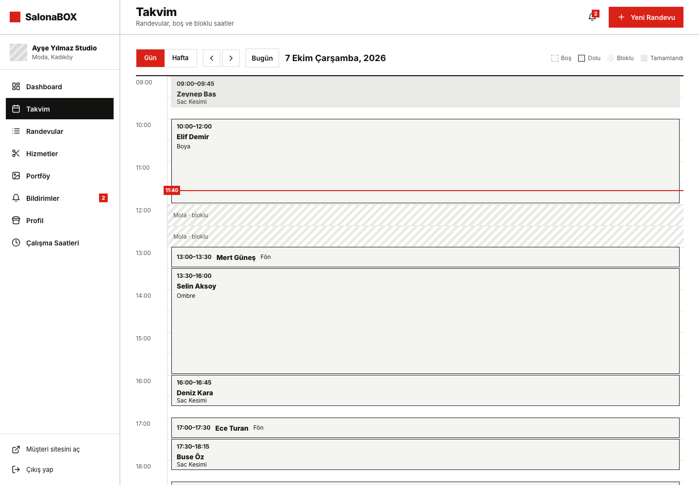
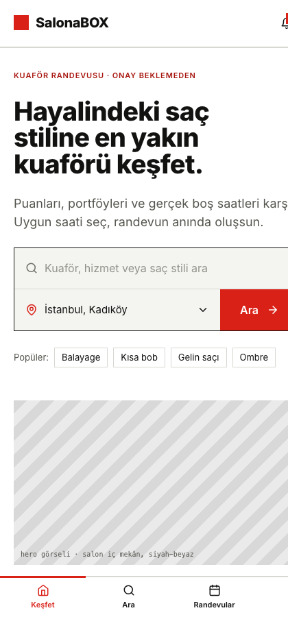

# SalonaBOX

Kuaför ve güzellik salonu randevu platformu. Müşteri salonları puan, portföy ve gerçek boş saatlere göre karşılaştırır, uygun saati seçer ve randevusu onay beklemeden oluşur. Salon sahibi ise randevularını, takvimini, hizmetlerini ve portföyünü tek bir panelden yönetir.



## İçindekiler

- [Özellikler](#özellikler)
- [Ekran görüntüleri](#ekran-görüntüleri)
- [Kullanılan teknolojiler](#kullanılan-teknolojiler)
- [Proje yapısı](#proje-yapısı)
- [Kurulum](#kurulum)
- [Sayfalar](#sayfalar)
- [API](#api)
- [Lisans](#lisans)

## Özellikler

### Müşteri

- Konuma göre yakındaki kuaförleri listeleme
- Hizmet, saç stili, puan ve mesafeye göre arama ve filtreleme
- Salon profili, portföy galerisi, değerlendirmeler ve çalışma saatleri
- Hizmet, tarih ve saat seçerek anında randevu alma
- Randevuları görüntüleme, değiştirme, iptal etme ve takvime ekleme
- Tamamlanan randevuya fotoğraflı değerlendirme yazma
- Bildirimler ve profil ayarları

### Salon paneli

- Günün özeti, doluluk oranı ve yaklaşan randevular
- Günlük ve haftalık takvim görünümü
- Elle randevu girme, randevuyu tamamlandı / gelmedi olarak işaretleme
- Hizmet ekleme, düzenleme, pasife alma
- Çalışma saatleri ve kapalı günler
- Portföy yönetimi, müşteri fotoğraflarını izinle yayınlama
- Salon profili ve bildirimler

## Ekran görüntüleri

| Kuaför arama | Salon detayı |
| --- | --- |
|  |  |

| Randevu alma | Randevularım |
| --- | --- |
|  |  |

| Panel girişi | Panel özeti |
| --- | --- |
|  |  |

| Panel takvimi | Mobil görünüm |
| --- | --- |
|  |  |

## Kullanılan teknolojiler

Projede kullanılan bütün paketler açık kaynak ve ücretsizdir; ücretli bir servis veya API kullanılmaz.

| Katman | Teknoloji |
| --- | --- |
| Arayüz | Next.js 16 (App Router), React 19, Tailwind CSS 4 |
| Sunucu | Node.js 20+, Express 5 |
| Veritabanı | MongoDB, Mongoose |
| Kimlik doğrulama | JWT (access + refresh token), bcrypt |
| Doğrulama | Zod |
| Görsel saklama | MongoDB GridFS |
| Güvenlik | Helmet, CORS, istek limiti |
| Test | Node test runner, Supertest, in-memory MongoDB |

## Proje yapısı

```
salonify/
├── client/                 Next.js arayüzü
│   └── src/
│       ├── app/            sayfalar (rotalar)
│       ├── components/     ortak bileşenler (atoms, molecules, organisms)
│       ├── features/       sayfa bazlı modüller
│       ├── data/           sabit listeler (kategoriler, şehirler)
│       ├── lib/            yardımcı fonksiyonlar, API istemcisi (axios)
│       └── styles/         genel stiller ve renk paleti
├── server/                 Express API
│   ├── src/                routes, controllers, services, models, validators
│   ├── scripts/            örnek veri script'i
│   └── tests/              API testleri
└── docs/ekran-goruntuleri/ README görselleri
```

## Kurulum

Gereksinim: Node.js 20 veya üzeri, MongoDB (yerel kurulum veya MongoDB Atlas ücretsiz paket).

Arayüz ve API aynı ortam dosyasını kullanır. Proje kökündeki `.env.example` dosyası `.env` olarak kopyalanıp doldurulur:

```bash
cp .env.example .env
```

Değişkenlerin açıklaması: [server/README.md](server/README.md#kurulum)

### Arayüz

```bash
cd client
npm install
npm run dev        # http://localhost:3000
```

Üretim derlemesi:

```bash
npm run build
npm start
```

### API

```bash
cd server
npm install
npm run seed       # örnek veriyi yazar
npm run dev        # http://localhost:5000/api
```

Gerekli ortam değişkenleri ve bütün uçların açıklaması için: [server/README.md](server/README.md)

## Sayfalar

### Müşteri

| Rota | Sayfa |
| --- | --- |
| `/` | Ana sayfa, kategoriler ve yakındaki kuaförler |
| `/kuaforler` | Kuaför arama ve filtreleme |
| `/kuaforler/[salonId]` | Salon detayı |
| `/kuaforler/[salonId]/randevu` | Randevu alma |
| `/randevularim` | Yaklaşan ve geçmiş randevular |
| `/randevularim/[id]` | Randevu detayı |
| `/randevularim/[id]/basarili` | Randevu oluşturuldu ekranı |
| `/randevularim/[id]/degerlendir` | Değerlendirme yazma |
| `/bildirimler` | Bildirimler |
| `/profil` | Profil ve ayarlar |

### Salon paneli

| Rota | Sayfa |
| --- | --- |
| `/panel/giris` | Panel girişi |
| `/panel` | Özet |
| `/panel/takvim` | Takvim |
| `/panel/randevular` | Randevu listesi |
| `/panel/hizmetler` | Hizmetler |
| `/panel/calisma-saatleri` | Çalışma saatleri ve kapalı günler |
| `/panel/portfoy` | Portföy |
| `/panel/bildirimler` | Bildirimler |
| `/panel/profil` | Salon profili |

## API

Hangi ucun hangi sayfada ne işe yaradığı [server/README.md](server/README.md) dosyasında anlatılıyor.

## Lisans

Tescilli yazılım, tüm hakları saklıdır. Ayrıntılar için [LICENSE](LICENSE).
